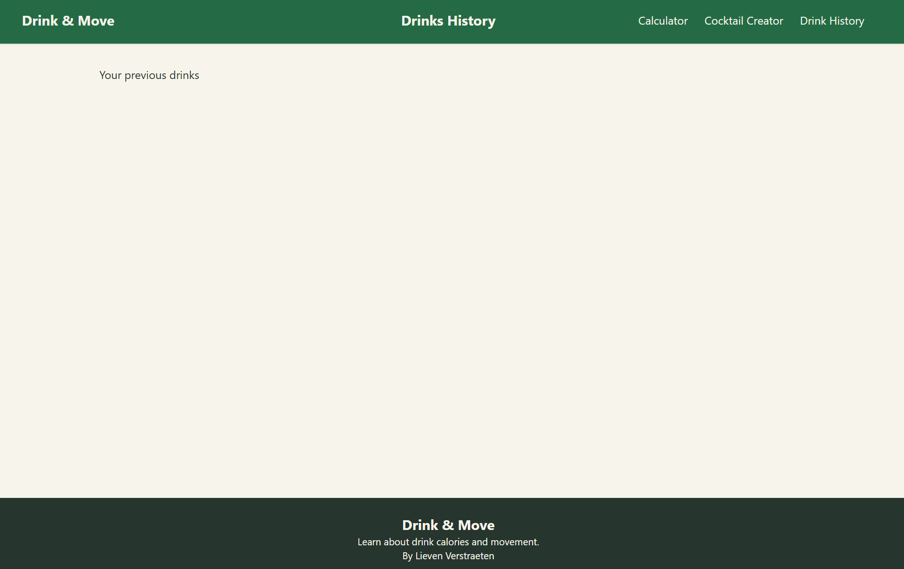

# Milestone 1 - Progress report
**Project: Drinks & Move**

## Progress:
I have a reusable layout (drink-move.blade.php) and created the reusable header and footer components.

In the header component I added a navbar going to all the pages I think I need using the named routes so I can change the view in routes later.

I also used my own color scheme for the website, changed in the app.css file to fit my website more.

I set up routes to all of my pages and put some dummy text in them filled in trough the {{$slot}}

**Remaining To Do**

I haven't gotten to the authentication of users yet, but that would only be necessary for the history, and maybe for the cocktail creator.

I also might have to make a component for the drinks, but I am going to do that after I have started on a table filled with the drink data.

The remaining thing would be removing the filler text and maybe improving the footer.

## Technical Decisions:

I knew I had to give every page a header and footer so, I thought those would be the easiest components and made them.

For the layout I took a lot of inspiration from the app.sidebar layout because I didn't know well what to do.

I also made an edit in the app.css part to change a few colors so it would fit my color scheme.

## Challenges:

I had a hard time figuring out how to work with layouts, how I should make my own and use it.

Luckily when creating the project we get the app and dashboard layout and from there I could see what I had to do to make my own layout.

## Next Steps:

Finish creating the main pages of the application.

Improve the styling and responsiveness of the navigation and page layouts.

Create additional reusable Blade components, such as cards for the drinks.

Start implementing the dynamic functionality using Livewire.

Plan the database structure for drinks, categories and saved calculations.

## Evidence:

resources/views/layouts/drink-move.blade.php    – Main application layout.

resources/views/components/header.blade.php     – Reusable navigation header.

resources/views/components/footer.blade.php     – Reusable footer.

routes/web.php                                  – Application routes.

resources/css/app.css                           – Tailwind CSS configuration and custom colour palette.

