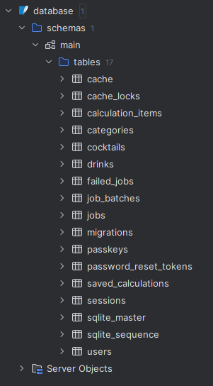
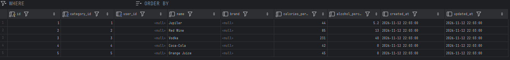

# Milestone 2 – Database Structure

## Progress

During this milestone I implemented the database structure for the Drinks & Move application using Laravel migrations, 
Eloquent models and seeders.

The database consists of the following tables:

- **users:** Laravel's existing authentication table, extended with a role column.
- **categories:** Stores drink categories such as beer, wine, spirits and soft drinks.
- **drinks:** Stores drink information, including its category, name, calories per 100 ml and alcohol percentage.
- **saved_calculations:** Stores users' saved calorie calculations and estimated walking and cycling times.
- **calculation_items:** Stores the individual drinks included in a saved calculation, including their quantities and serving sizes.
- **cocktails:** Stores cocktails created by users.
- **cocktail_drink:** A pivot table connecting cocktails to drinks and storing the quantity of each ingredient.

I also created the corresponding Eloquent models, defined their relationships and implemented seeders to populate the database with representative test data.

The database was successfully tested using `php artisan migrate:fresh --seed`.

Functional CRUD operations and integration with the user interface are not implemented yet, as these are outside the scope of this milestone.

## Technical Decisions

I chose a relational database structure because the application contains several connected entities.

The most important relationships are:

- **Category – Drink:** A category can contain multiple drinks, while each drink belongs to one category.
- **User – Drink:** A user can create multiple custom drinks. Catalogue drinks can exist without being linked to a user.
- **User – SavedCalculation:** A user can have multiple saved calculations, while each calculation belongs to one user.
- **SavedCalculation – CalculationItem:** A calculation can contain multiple items, with each item belonging to one saved calculation.
- **Cocktail – Drink:** A cocktail can contain multiple drinks, and a drink can be used in multiple cocktails. This is implemented using a many-to-many relationship and the `cocktail_drink` pivot table.

I also store the drink name and calorie value in each calculation item. This preserves the original information used in a calculation, even if the drink's information changes later.

Foreign keys and deletion rules were added to maintain referential integrity and prevent invalid relationships between records.

## Challenges

One challenge was that I used AI to make the migration and models, 
before getting to the seeder and finding out that it used depreciated functions for them.
So I had to redo most of them which took me a while.

I also encountered a database error because the seeder did not provide the required 
`calories_per_100ml` value when creating calculation items. 
I solved this by updating the seeder and model to include the missing field.

## Next Steps

In the next milestone, I will focus on integrating the database into the application.

My priorities are:
- Implementing CRUD operations for drinks and cocktails.
- Retrieving drink categories and drinks from the database.
- Connecting the calculator to the database so users can select drinks.
- Saving calculations and their individual items.
- Displaying saved calculations and user-created cocktails.

## Evidence

Relevant implementation files:

`database/migrations/` – Database table definitions and foreign keys.

`app/Models/` – Eloquent models and relationships.

`database/seeders/` – Seeders and representative test data.

`database/seeders/DatabaseSeeder.php` – Main seeder that executes the other seeders.

Database verification:

Command used: `php artisan migrate:fresh --seed`
Result: All migrations executed and the database was populated with test data successfully.
